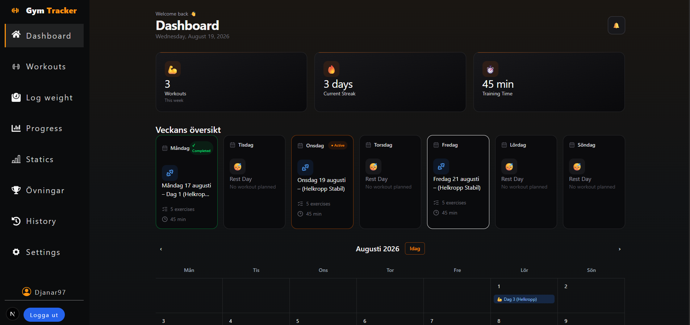
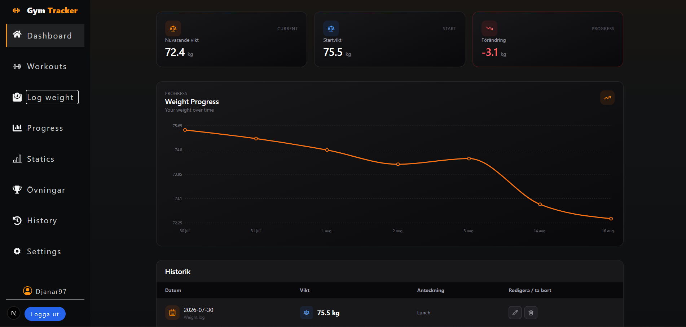
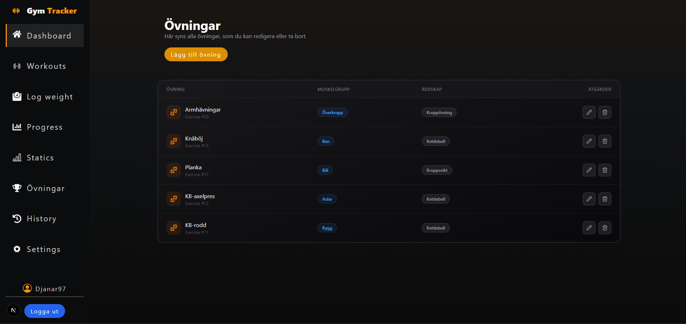
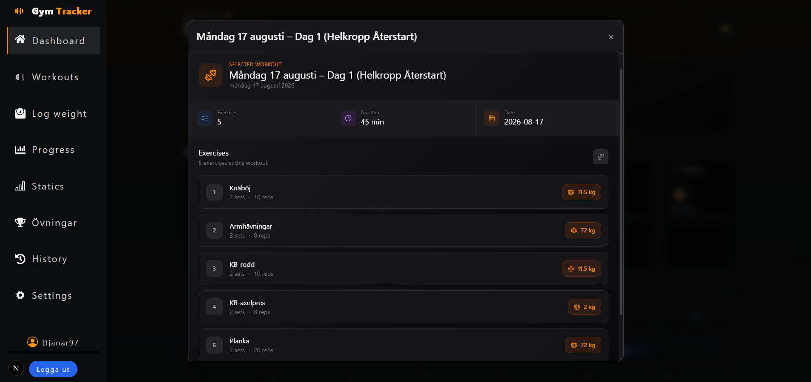

# 🏋️ GymTracker

GymTracker is a full-stack fitness tracking application built with Next.js, TypeScript, Prisma and MySQL.

The application allows users to manage their fitness goals, workouts and workout sessions while tracking their progress over time.

## Database migrations

GymTracker uses Prisma ORM with MySQL.

### Existing databases

The local MySQL database and the TiDB Cloud production database use the existing migration history in `prisma/migrations`. Keep these migrations available so Prisma can validate the migration history of existing databases.

### Baseline migration

A baseline SQL file is being prepared under `prisma/migrations-baseline`. It has been tested against a separate database, and its schema matches `prisma/schema.prisma`.

The baseline is not yet the active Prisma migration directory. Do not replace the existing migrations or mark the baseline as applied in an existing database until the transition has been verified.

### Creating future migrations

After changing `prisma/schema.prisma`, create and test a migration against the local development database:

```bash
npx prisma migrate dev --name describe_your_change
```

Deploy approved migrations to the production database using:

```bash
npx prisma migrate deploy
```

Always verify the target database and take an appropriate backup before applying migrations. Never use `prisma migrate reset` on a database containing data that must be preserved.

## ✨ Features

- 🔐 User authentication
- 👤 User profile and settings
- 🎯 Fitness goals
- 🏋️ Workout management
- 📅 Workout scheduling
- 📊 Dashboard with weekly overview
- ✅ Workout session tracking
- 📈 Progress tracking
- 🔒 Protected routes with middleware
- 🗄️ MySQL database with Prisma ORM
- 🔌 REST API endpoints
- 🧩 Service and repository architecture
- 📱 Responsive UI

## 📸 Screenshots

<p align="center">
  
  
</p>
<br />
<p align="center">
  
  
</p>

## 🛠️ Tech Stack

### Frontend

- Next.js
- React
- TypeScript
- CSS Modules
- React Icons

### Backend

- Next.js API Routes
- TypeScript
- Prisma ORM
- MySQL
- JWT authentication

### Development

- Node.js
- npm
- Git
- GitHub

## 🏗️ Architecture

The project follows a layered architecture separating API routes, services, repositories and data models.

```text
app/
├── api/
│   ├── auth/
│   ├── workouts/
│   ├── workout-sessions/
│   └── ...
│
├── dashboard/
├── login/
└── register/

services-server/
├── auth-service.ts
├── workout-service.ts
├── workout-session-service.ts
└── ...

repositories/
├── auth-repository.ts
├── workout-repository.ts
├── workout-session-repository.ts
└── ...

types/
├── api-types.ts
├── user-types.ts
├── workout-types.ts
└── ...

schemas/
├── auth-schemas.ts
└── ...
```
